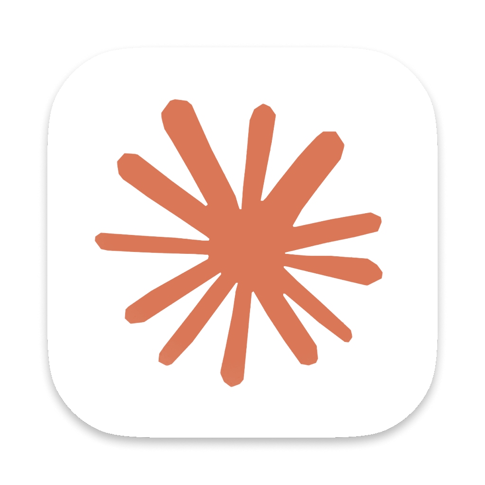

# Claude: two accounts on one Mac

Runs two Claude desktop accounts at the same time on one Mac, with **both linked to the computer** (folders, files, Cowork):

- **Claude Mica** (`~/Applications/Claude Mica.app`): work account, with the official icon
- **Claude Personal** (`~/Applications/Claude Personal.app`): personal account, with a white icon and an orange star

Both are small launchers for the official `/Applications/Claude.app`. Keep both in the Dock: each one opens its account, or brings it to the front if it's already open.



## Setup on a new Mac

1. Install Claude from <https://claude.ai/download> into `/Applications`.
2. Clone this repo and run the installer:
   ```bash
   git clone https://github.com/stajulian5/claude-dual-accounts.git ~/dev/claude-dual-accounts
   cd ~/dev/claude-dual-accounts && ./install.sh
   ```
3. Quit Claude, open **Claude Personal** from `~/Applications`, and sign in with the personal account.
4. Quit it, open **Claude Mica** from `~/Applications`, and sign in with the work account.
5. Drag **Claude Mica** and **Claude Personal** to the Dock, and remove the plain Claude icon from it.
6. Optional: to open both at login, add them in System Settings → General → Login Items.

Sign-ins and chats are not part of this repo. They live in your Claude accounts, so you only sign in again.

## How it works

Each launcher starts the **official** Claude.app. Claude Mica uses Claude's normal data folder. Claude Personal starts a second instance with its own data folder:

```bash
open -n -a /Applications/Claude.app --args --user-data-dir="$HOME/Library/Application Support/ClaudeProfiles/personal"
```

Each data folder keeps its own sign-in, so each instance is a separate account. Because the official app is not copied or modified, both instances keep Anthropic's code signature, and both update themselves.

## Why not copy and re-sign Claude.app?

That was the earlier setup (`rebuild-profiles.sh`). It stopped working in November 2026, with version 5.1231.x. The link from a chat to the Mac uses a device key kept in the Mac's Secure Enclave, and only the Anthropic-signed app can use it. A re-signed copy still runs and chats, but gets "Couldn't link this session to a computer".

## Files

| File | Purpose |
|---|---|
| `install.sh` | One-step setup on a new Mac |
| `make-apps.sh` | Builds `Claude Mica.app` and `Claude Personal.app` in `~/Applications` (run once per Mac) |
| `claude-launch.sh` | The launcher itself. From Terminal: `PROFILE=default ./claude-launch.sh` (Mica) or `./claude-launch.sh` (personal) |
| `assets/claude-personal.icns` | Launcher icon (white with an orange star) |

## Things to know

- **Sign in with one instance running.** A sign-in returns to whichever Claude opened first.
- **Don't sign one instance out of an account the other is using.** Signing out removes every link that account has to the Mac, including the other instance's.
- **Use the launchers, not the plain Claude icon.** The plain icon stands for the app, not an account. With Personal already open, clicking it can bring Personal to the front instead of opening Mica.
- **Extra Dock icons while running.** Each open account also shows a standard Claude icon in the Dock. The named icons belong to the launchers.
- **No rebuild after updates.** Both instances use the same official app.
- **Another profile:** `PROFILE=other ./claude-launch.sh` starts a third account with its own data folder.
- **First use of a launcher:** macOS may ask to let it control "System Events". Allow it, so the launcher can bring an open account to the front.

## Troubleshooting

- **"Couldn't link this session to a computer" in Personal:** quit Personal, then start it again from the launcher, not from an old copied app. Start a **new** task and choose this Mac.
- **The Dock shows the old icon:** remove the launcher from the Dock and add it again, or run `killall Dock`.
- **Logs:** `~/Library/Logs/Claude/main.log` (both instances write to it). Search for `remote-tools-device`.
